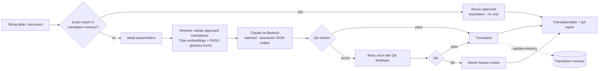

# bedrock-rag-translator

[](https://github.com/Jebason-Chellakumar/bedrock-rag-translator/actions/workflows/ci.yml)


**Retrieval-augmented translation for product and training content**, using Claude on Amazon Bedrock. It translates string tables and documents into many languages while staying consistent with your **approved past translations** and **glossary**. It never breaks `{{placeholders}}`, runs automatic QA on every segment, and sends only real problems to human reviewers.

Plain machine translation of product content usually fails in predictable ways:

| Problem | What this does |
|---|---|
| The same term translated three different ways across releases | Retrieves the most similar **approved translations** (Titan embeddings + FAISS) and puts them in the prompt as references |
| Brand and product terms get translated, domain terms drift | The **glossary** is injected per segment and *enforced* by QA. Do-not-translate terms must survive unchanged |
| `{{company_url}}`, `{name}`, `%s`, `<a href>` get translated, reordered or dropped | Placeholders are **masked as opaque tokens** before the model sees them, restored afterwards, and QA checks each comes back exactly once |
| Wrong formality (`du` vs `Sie`, `tú` vs `usted`), Spain vs Mexico vocabulary | **Per-locale style rules** in every request |
| Paying again for sentences you've already translated | **Exact memory matches are reused** with no model call |
| Brittle parsing of model output | **Structured outputs** (JSON schema), so the response is always valid JSON |
| Silent bad output | **QA → automatic retry with the QA feedback → human review queue**, plus a Markdown report |



## QA checks

| Check | Severity |
|---|---|
| Placeholder missing, duplicated or invented | error → retry, then review |
| Glossary term not used / do-not-translate term changed | error → retry, then review |
| Empty translation, or the model declined | error → review |
| Number missing (allows `1.50` ↔ `1,50`) | warning |
| Translation identical to source | warning |
| Unusual length ratio (CJK-aware) | warning |

## Try it with no AWS account

The sample is a fictional training app ("LearnHub") with 12 UI strings, a glossary, and approved translations in German, French, Mexican Spanish and Japanese.

```bash
python -m venv .venv && source .venv/bin/activate
pip install -e ".[dev]"

rag-translate strings sample/strings.csv --locales de-DE,ja-JP \
  --glossary sample/glossary.csv --memory sample/memory.csv --embedder hash --dry-run
```

`--dry-run` shows exactly what each segment would be sent with:

```
[course.due_today] You have {count} courses due today.
  glossary: course => Kurs
  reference (0.82): You have {count} courses due this week. -> Diese Woche sind {count} Kurse fällig.

[supervisor.assigned] Your supervisor assigned you a new course: {course}.
  glossary: supervisor => Führungskraft
  glossary: course => Kurs

[auth.logout] Log out
  memory: exact match, reused without a model call -> Abmelden
```

## Run it for real (Amazon Bedrock)

Enable model access for Claude and Titan Text Embeddings V2 in the Bedrock console, then:

```bash
rag-translate strings sample/strings.csv --locales de-DE,fr-FR,es-MX,ja-JP \
  --glossary sample/glossary.csv --memory sample/memory.csv \
  --region us-east-1 --out out/translated.csv --report out/report.md

# Documents (Markdown / text), paragraph by paragraph; code blocks are left alone
rag-translate document guide.md --locale ja-JP --memory sample/memory.csv --out out/guide.ja.md
```

The command exits with code `1` when anything needs human review, so it can gate a CI localization step. `--update-memory` adds translations that passed QA to the memory, so the next run is more consistent and cheaper. Keep that behind human approval in production.

### Serverless deployment

[`infra/template.yaml`](infra/template.yaml) (SAM) creates a versioned, encrypted S3 bucket and a Lambda function. Uploading `incoming/<name>.csv` triggers a translation into `translated/<name>.csv` plus `translated/<name>.report.md`. The glossary and memory live in `config/`. The stack also sets reserved concurrency (to bound Bedrock spend), X-Ray tracing and an error alarm.

```bash
./scripts/package.sh && sam build -t infra/template.yaml && sam deploy --guided
aws s3 cp sample/glossary.csv s3://<bucket>/config/glossary.csv
aws s3 cp sample/memory.csv   s3://<bucket>/config/memory.csv
aws s3 cp sample/strings.csv  s3://<bucket>/incoming/release-42.csv
```

## Design notes

- **Retrieval is per locale.** Each target locale has its own vector index over the English sources, so a German request only ever sees German references.
- **Batching with automatic splitting.** About 25 segments go in each request. If a response hits `max_tokens`, the batch is halved and retried, down to single segments.
- **Locales run in parallel.** The system prompt is fixed and prompt caching is on, so repeated batches reuse the cached prefix.
- **FAISS is optional.** It's used when installed. Otherwise an exact NumPy search returns identical results, which keeps the Lambda package small.
- **Offline mode.** The `hash` embedder lets you run the whole pipeline and its tests with no credentials. Titan V2 (512-dim, normalised) is used in production.

## Project layout

```
translator/
  placeholders.py  mask / restore {{vars}}, {vars}, %s, markup, URLs
  glossary.py      term matching (plural-aware, ignores placeholders) + compliance
  embeddings.py    Titan Text Embeddings V2 (Bedrock) · offline hashing embedder
  memory.py        translation memory: exact lookup + FAISS/NumPy similarity search
  llm.py           Claude on Bedrock: prompt, locale styles, JSON schema output
  qa.py            automatic quality checks
  pipeline.py      memory → retrieve → translate → QA → retry → review
  segments.py      CSV string tables, Markdown documents
  report.py        Markdown QA report
  cli.py           rag-translate strings | document
  lambda_handler.py  S3-triggered serverless entry point
infra/template.yaml  SAM: bucket, function, trigger, IAM, alarm
tests/             34 tests: masking, glossary, QA, retrieval, pipeline, CLI, Lambda
```

## License
MIT. Built by [Jebason Chellakumar](https://www.linkedin.com/in/jebason-chellakumar), Cloud Solutions Architect (AWS Certified Solutions Architect – Associate).
